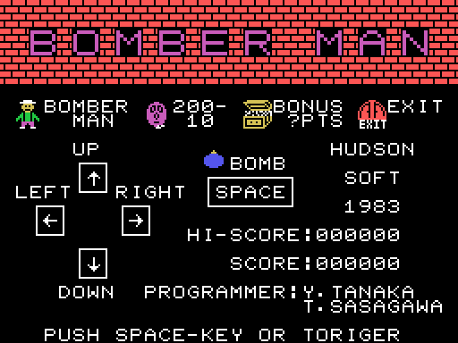
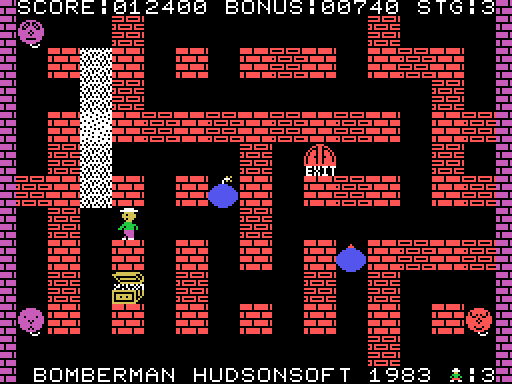

# The game

Bomber Man, by Hudson Soft, 1983. Eight kilobytes. You drop a bomb, you run,
the bomb breaks the bricks next to it, and under one of them is the door.



The title screen, drawn from the ROM. At the top the big wordmark — not a
stored picture but nine two-by-two letters painted by a loop — and below it a
**legend** that explains the whole game: the bomber, the monster with what it
is worth, the prize chest and the door.

## The rules, measured on the code

| thing | value | where |
|---|---|---|
| board | 15 columns × 11 rows | `0x4E15` |
| fixed pillars | 35, where both coordinates are odd | `0x4DB7` |
| bricks per stage | 35 draws, repeats allowed | `0x4E65` |
| lives | 3 | `0x4069` |
| starting bonus | 1000, dropping by 10 every 50 frames | `0x4080` |
| bombs at once | 5 | list at `0xE359` |
| enemies at once | 8 | list at `0xE31C` |

The score is shown **multiplied by ten**: `escribe_cinco_cifras_y_un_cero`
(`0x4F29`) prints five digits and sticks a zero on the end. The caller strips
that zero off the bonus, and into the gap it leaves fits the leading space of
`" STG:"`.

## How many enemies, and how fast

The table at `0x4217`, two bytes per stage. From the sixth on, every stage
plays with the fifth line.

| stage | enemies | cadence |
|---|---|---|
| 1 | 1 | `0x10` |
| 2 | 2 | `0x15` |
| 3 | 3 | `0x1A` |
| 4 | **2** | `0x1F` |
| 5 and on | 4 | `0x24` |

Stage four has **fewer** enemies than stage three. It is the first auto-bomb
stage, which may be why.

## The auto-bomb stages

Every fourth stage the game stops asking for the trigger and **drops the bombs
itself**. Two instructions decide it, `0x4922` and `0x4D3A`, with the same
`and 003h` on the stage number: one disables the trigger check and the other
turns on the label that announces it at the bottom, blinking sixteen frames on
and eight off:

```
  BOMB AUTO SETTING STAGE
```

## How you die

Two ways, and **one single comparison** covers both. When painting the bomber,
`pinta_una_casilla_del_bombero` (`0x4BEB`) looks at what was underneath: if it
is `0xC0` or above, the death animation starts. Monsters live from `0xC0` to
`0xCF` and flames from `0xE0` to `0xEF`, laid out next to each other on
purpose.

Because the bomber is painted **after** the enemies and the flames, what it
reads is this very frame's.


Eight frames, running backwards through the tile sheet: from `0x4E` down to
`0x40`. The last one is not a drawing of the bomber, it is a green **OUT** on
top of what is left of him.

## The monster hunting you is the red one

The same byte of the enemy's record picks the drawing and decides the
behaviour. When it is zero, the enemy **goes after the bomber** (`0x477B`); the
rest of the time it wanders and changes its mind at random. And zero is
precisely the red drawing frame.


The first two are frame 0. The other six, purple.

## What everything is worth

- **A monster**: `(drawing frame × 4) + 2`, plus a random number from 1 to 4.
  That is 3 to 18, or **30 to 180 points** on screen. The title screen's
  legend, next to the monster, announces `200-10`.
- **The prize**: a random number between `0x10` and `0x7E`, always even and
  always with bit 4 set. Between **160 and 1260 points**.
- **The bonus**: on clearing the stage it is turned into score ten at a time,
  with a beep for each ten.

## The two ways to finish a stage

**Step on the door** (`0xE316`) or **kill everything** (`0xE318`). Only the
second one collects the bonus.

And there is a third that is not an ending but a punishment: if the bonus
reaches zero, `se_agoto_el_bonus` (`0x449F`) **wipes the whole board**. The
thirty-five bricks, the prize and the door vanish at once, and with both
"already found" flags set they are never looked for again. The stage is left
with no way out.



A game in progress, dealt with the cartridge's three rules and painted with its
routines. The bricks are **one of the possible deals**: the real one is decided
by the Z80's R register at the instant the trigger is pressed.
