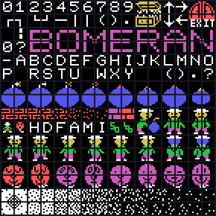
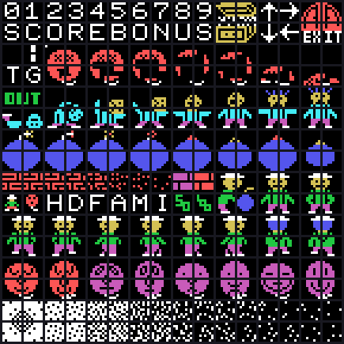

# El cartucho

8 KB en la página 1 (`0x4000`–`0x5FFF`), MSX1. Es el cartucho más pequeño de la
serie, y el primero de Hudson Soft.

## La cabecera es código

Un cartucho de MSX empieza por `AB`, la dirección de INIT, y luego STATEMENT,
DEVICE, TEXT y seis bytes reservados. Aquí INIT vale `0x4004`, que es justo
donde deberían empezar esos campos. Leídos como instrucciones:

```
4000  41 42        "AB"
4002  04 40        INIT = 0x4004
4004  31 00 F0     ld sp,0F000h
4007  CD D1 4F     call 4FD1h        los valores de partida de la RAM
400A  CD 62 50     call 5062h        el VDP
400D  CD 4E 40     call 404Eh        el PSG, con su tabla pegada detrás
```

Sólo los **cuatro primeros bytes** del cartucho son cabecera de verdad. Los
otros nueve son las cuatro primeras instrucciones, y no queda ni un byte para
STATEMENT, DEVICE o TEXT.

## El mapa de memoria

| dónde | qué |
|---|---|
| `0x4000`–`0x5FFF` | el cartucho |
| `0xE000`–`0xE2FF` | **la pantalla**, 768 bytes: lo que se ve |
| `0xE300`–`0xE389` | las variables |
| `0xE38A`–`0xE689` | **el tablero**, otros 768 bytes: lo que permanece |
| `0xF000` | la pila |

Las dos pantallas de la RAM son lo que organiza el juego entero, y están
explicadas en [El código](EL-CODIGO.html).

## El VDP

Los ocho registros salen de la tabla de `0x5144` y los vuelca `monta_el_vdp`
(`0x5062`):

| registro | valor | qué dice |
|---|---|---|
| R0 | `0x02` | SCREEN 2 |
| R1 | `0xC2` | 16 KB, pantalla encendida, sprites de 16×16 |
| R2 | `0x06` | tabla de nombres en `0x1800` |
| R3 | `0x7F` | color en `0x0000`, tres bancos de `0x800` |
| R4 | `0x07` | patrones en `0x2000`, tres bancos |
| R5 | `0x38` | atributos de sprite en `0x1C00` |
| R6 | `0x07` | patrones de sprite en `0x3800` |
| R7 | `0xF0` | tinta blanca sobre fondo transparente |

**Los registros de sprite se declaran y no se usan.** Justo después de
volcarlos, `0x507C` escribe un `0xD0` en el primer atributo —la marca de «no
hay más sprites»— y el cartucho **no vuelve a tocar la lista nunca**. Todo lo
que se mueve en este juego son casillas de la tabla de nombres.

## Sin interrupción y sin sincronismo

`monta_el_vdp` mete un `ret` en H.TIMI (`0xFD9F`): la BIOS deja de meter mano
en cada interrupción. Y el juego **no espera al barrido de la pantalla**: el
ritmo lo marca un bucle en vacío de `0x500` vueltas al final de
`cierra_el_cuadro` (`0x46C8`). La pantalla se vuelca cuando toca, no cuando el
VDP está a salvo.

## Los tres bloques de gráficos

El formato de `carga_los_graficos_en_los_tres_tercios` (`0x5088`) es:

```
2 bytes   destino en la VRAM; al byte alto se le suma el tercio
1 byte    cuántas casillas, y el CERO vale 256
n*8       los patrones, que LDIRVM vuelca de golpe
parejas   (color, cuántas casillas) que FILVRM pinta, cerradas por 0xFF
```

Se llama tres veces con A = 0, 8 y `0x10`, que sumados al byte alto del destino
dan los tres tercios de SCREEN 2.

| bloque | destino | casillas | qué trae |
|---|---|---|---|
| `0x514C` | `0x0000` | 256 | la portada entera |
| `0x5B26` | `0x0080` | 10 | las letras de SCORE y BONUS |
| `0x5B7C` | `0x0100` | 64 | las cifras, los bichos y el bombero |

**Los tres teselan sin un hueco**: `0x514C` acaba en `0x5B26`, que acaba en
`0x5B7C`, que acaba en `0x5E38`. Eso es lo que prueba que el formato está bien
leído: si el recuento de casillas o el de tramos de color estuviera mal por un
byte, el bloque siguiente no empezaría donde empieza.

## La fuente cambia a mitad de juego

El bloque grande carga las 256 casillas de la portada. Al empezar la partida,
`0x4074` y `0x407A` cargan los dos pequeños **encima**: donde la portada tiene
el rótulo grande de BOMBER MAN, la partida pone los bichos.

Lo de la casilla `0x90` para arriba **no se sobreescribe nunca**, y de ahí
salen la H, la D, la F, la A, la M y la I que hacen falta en el rótulo de
abajo. Por eso el letrero de la partida se escribe con casillas de **tres
bloques distintos**, y por eso no hay forma de leer un texto de este cartucho
sin dibujarlo.





## El sonido

Dos formatos, los dos con parejas (registro, valor) cerradas por `0xFF`.

**El corto va incrustado detrás del `call`.** `vuelca_la_tabla_del_psg`
(`0x404E`) empieza con un `pop hl`: no recoge un dato, recoge la **dirección de
retorno**, que es donde empieza la tabla porque la tabla va pegada detrás del
`call`. Al acabar hace `push hl / ret` y sigue ejecutando **detrás** de ella.
Hay tres sitios así, y son las tres zonas del `.nocode`.

**El largo se guarda con un puntero por voz**, en `(0xE305)` y `(0xE307)`, y
`sigue_los_dos_guiones_de_sonido` (`0x4025`) lo va siguiendo un cuadro por
vuelta. Aquí cada `0xFF` cierra el cuadro, no el guion: el guion se acaba con
un `0xFF` doble. Hay cinco: la fanfarria de la puerta, el premio recogido, el
enemigo reventando, la agonía del bombero y el paso.
